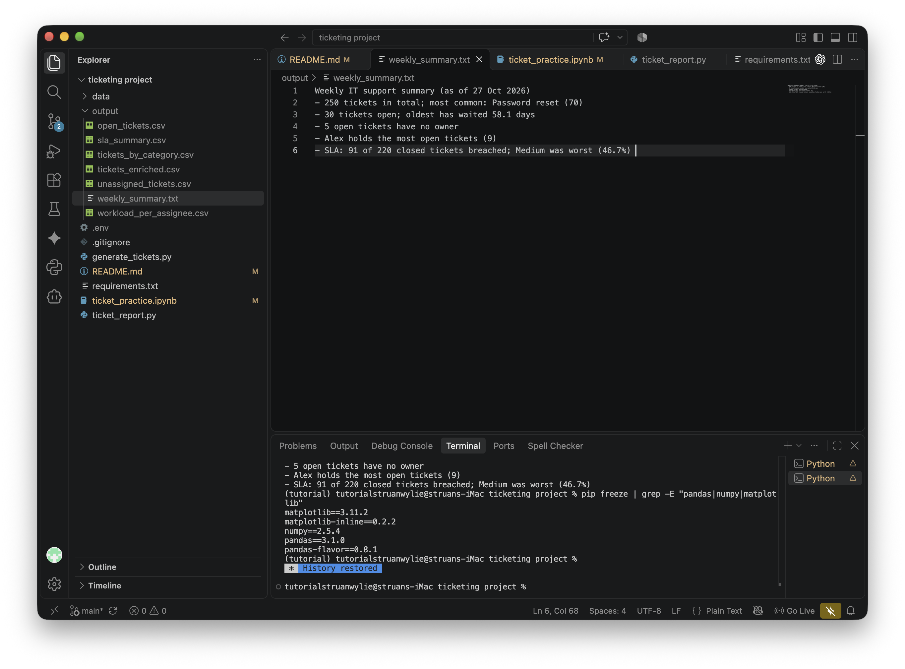

# Help-desk ticket report

This is a Python script designed to turn raw help-desk tickets into weekly reports: ticket volume, open backlog, unassigned tickets, workload per person and SLA performance.

I wrote this Python script to help me practice pandas and NumPy on the kind of reporting an IT support team would work through every week.

## How to run it
1. To run it, proceed with downloading the requirements, found in requirements.txt.
2. Run generate_tickets.py to generate the tickets.csv.
3. Then run the ticket_report.py script to create the weekly_summary.txt; found in the `/output `folder. The script also writes five CSV reports.
Reports are saved to 'output/' folder.
```bash
pip install -r requirements.txt
python generate_tickets.py
python ticket_report.py
```

## What it produces

- `tickets_by_category.csv`: most common request types
- `open_tickets.csv`: unresolved tickets, oldest first
- `unassigned_tickets.csv`: open tickets without an owner
- `workload_per_assignee.csv`: open tickets per person
- `sla_summary.csv`: SLA breaches and breach rate per priority
- `weekly_summary.txt`: a plain-English summary for a team meeting

## Example summary


```
Weekly IT support summary (as of 27 Oct 2026)
- 250 tickets in total; most common: Password reset (70)
- 30 tickets open; oldest has waited 58.1 days
- 5 open tickets have no owner
- Alex holds the most open tickets (9)
- SLA: 91 of 220 closed tickets breached; Medium was worst (46.7%) 
```

## About the data
The generated tickets are completely synthetic, and the generator always produces the same 250 tickets, so results are reproducible.
The generator has been designed to create realistic problems on purpose: blank categories, unassigned tickets, uneven workload, and SLA breaches. These emulate real world conditions and give me some challenges.

## What I learned
Through the process of working through this project (by working alongside a YouTube pandas tutorial, using coffee shop and Olympic games datasets), I have been able to understand the method and syntax of using pandas and NumPy, for example, using a lookup table and merge for SLA targets, and learning to restart and rerun my notebook after changing cells.

## What's next
Going forward I would like to incorporate the use of Matplotlib to improve the visual ease of some of the datasets. 
